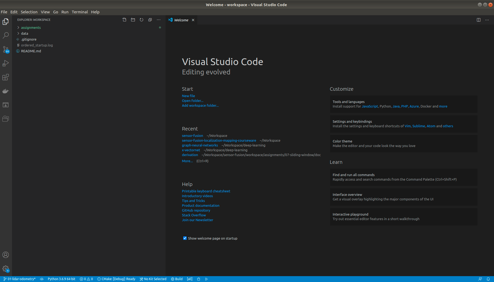

# LiDAR-based Multi-Sensor Fusion Localization and Mapping

Learning environment for the [Multi-Sensor Fusion Localization/Sensor Fusion](https://www.shenlanxueyuan.com/my/course/261) course at Shenlan Academy.

---

## Overview

This repository provides a learning environment for the [Multi-Sensor Fusion Localization/Sensor Fusion](https://www.shenlanxueyuan.com/my/course/261) course, based on **ROS melodic** on **Ubuntu 18.04**. 

To save time on installation and configuration:

* Some dependencies are difficult to obtain due to network issues

* Introducing new dependencies may cause conflicts with local dependencies

The above environment will be provided as a **Docker Image** to isolate it from the native PC environment. The native PC operating system for this project should be **Ubuntu**. Windows and Mac are not recommended; if you intend to try them, please search for relevant solutions on your own.

---

### Install Ubuntu

First, ensure that you have access to an **Ubuntu** development environment. If you do not have an **Ubuntu** environment, please follow the [guide linked here](ubuntu-setup/README.md) to install and configure **Ubuntu** on your local PC.

---

### Obtain Docker Development Environment

This course recommends using the official Docker environment [linked here](docker/README.md) to complete the coursework. Docker provides a lightweight, standardized development environment that helps avoid many issues caused by configuration differences.

---

### Workspace

Once both the Native PC and the Course Docker Environment are ready, you can start using this development environment:

* On first use, please download the KITTI test data provided with the course first.

* Afterward, you can complete the course assignments using the **local VSCode development, Docker internal compilation and testing** workflow.

#### Obtain Course Data

On first use, you need to download the **course-provided fixed KITTI data** to your local file system. For specific instructions, refer to [click here](workspace/data/kitti/README.md).

#### Development, Compilation, and Testing

After starting the Docker environment, the /workspace directory in **Docker** will be mapped to the workspace directory in the **current repository**.

The workflow for development, compilation, and testing in this workspace is as follows:

* In the **workspace of the current repository**, launch [VSCode](https://code.visualstudio.com/) to edit the source code:

* Perform compilation in the **Docker /workspace** directory. For specific compilation instructions, please refer to [Assignment 0 Hello, KITTI](workspace/assignments/00-hello-kitti/README.md)

---

Keep Learning & Keep Coding

Ge Yao, alexgecontrol@qq.com
